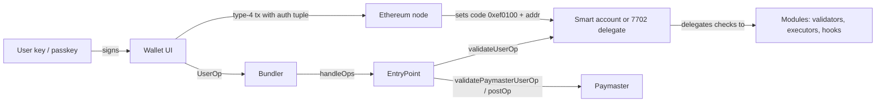

# From EOAs to Programmable Accounts

For most of Ethereum's history, an account was either an **externally owned account (EOA)**, controlled by one private key, or a **contract**, controlled by code. Account abstraction (AA) blurs the line: the user's account becomes code that decides what counts as a valid authorisation.

## The three routes

| Route | Status | What changes |
|---|---|---|
| ERC-4337 | live since 2023, no protocol change | `UserOperation`s go to an alternative mempool; bundlers submit them to a singleton `EntryPoint` contract |
| EIP-7702 | live since Pectra (2025) | an EOA signs an authorisation that sets its code to a delegation pointer to a contract |
| Native AA on L2s | e.g. zkSync Era, Starknet | every account is a contract at the protocol level |

The routes compose. A 7702-delegated EOA can point at a contract that also implements the ERC-4337 account interface, so the same address can send ordinary transactions with its key *and* receive sponsored `UserOperation`s through a bundler. That combination is now common in wallets, and it is where many of the subtle bugs in this book live.

## Why security people should care

AA moves security decisions from the protocol into **user-chosen code**:

- Validation logic (who may sign) is a contract, and contracts have bugs.
- New actors appear: bundlers, paymasters, aggregators, module developers.
- New signing objects appear: `UserOperation` hashes, 7702 authorisation tuples, session-key grants. Wallet UIs and hardware wallets often display these poorly.
- Assumptions in existing contracts break, such as "`tx.origin == msg.sender` means an EOA without code".

The last point deserves emphasis. A lot of deployed code uses "caller is an EOA" as a cheap anti-bot or anti-flash-loan check. Under 7702, an address can be an EOA (it has a private key and can originate transactions) *and* run arbitrary code when called. Under 4337, the "user" is a contract, so checks like `require(msg.sender == tx.origin)` lock smart-account users out entirely. Both directions are bugs: one is a security bypass, the other is a denial of service for legitimate users.

## Threat model summary

```
user ── signs ──► UserOp / 7702 auth / session grant
                    │
          wallet UI │ (can mislead)
                    ▼
bundler (can censor, grief) ──► EntryPoint ──► account validation (can be buggy)
                                   │                │
                          paymaster (can be drained) modules (can be malicious)
```

The same flow as a sequence of trust hand-offs:



Each arrow is a place where one party trusts another to have checked something. Audits in this space mostly consist of asking, for every arrow, "what does the receiver assume the sender verified, and is that true?"

## How to tell what an address is

Before reasoning about any AA bug you need to know what kind of account you are dealing with. There are now four cases on Ethereum mainnet:

| Case | `eth_getCode` returns | Can originate txs? | Runs code when called? |
|---|---|---|---|
| Plain EOA | `0x` | yes | no |
| Contract (incl. 4337 account) | contract bytecode | no | yes |
| 7702-delegated EOA | `0xef0100` followed by 20-byte delegate address | yes | yes, the delegate's code |
| Counterfactual 4337 account | `0x` until first UserOp deploys it | no | not yet |

The counterfactual case surprises people: a smart account's address is known (computed with `CREATE2` by the factory) before any code exists there, and funds can be sent to it. Code that treats "no code" as "EOA" will misclassify it.

## Worked example

*Execution status: not executed in this book's CI; verify locally.*

This walk-through runs entirely on a local Anvil node. It shows the three account states and a contract whose "EOA only" check stops meaning what its author thought.

1. Start a Pectra-enabled node (recent Anvil defaults to Prague, but be explicit):

```bash
anvil --hardfork prague
```

2. Write a naive guard and a trivial delegate in a Foundry project:

```solidity
// src/OnlyHumans.sol
pragma solidity ^0.8.24;

contract OnlyHumans {
    uint256 public claims;
    function claim() external {
        // Author's belief: "the caller is a human with a key, not a contract"
        require(msg.sender == tx.origin, "no contracts");
        require(msg.sender.code.length == 0, "no code");
        claims++;
    }
}

// src/Batcher.sol
contract Batcher {
    struct Call { address to; uint256 value; bytes data; }
    function execute(Call[] calldata calls) external payable {
        require(msg.sender == address(this), "only self");
        for (uint256 i; i < calls.length; i++) {
            (bool ok,) = calls[i].to.call{value: calls[i].value}(calls[i].data);
            require(ok, "call failed");
        }
    }
}
```

3. Deploy both with `forge create` using Anvil's first default key, and note the addresses. Then inspect account 1 (a plain EOA):

```bash
cast code 0x70997970C51812dc3A010C7d01b50e0d17dc79C8
# 0x
```

4. Delegate account 1 to `Batcher` with a type-4 transaction. `cast send --auth` signs the authorisation tuple and includes it:

```bash
cast send 0x70997970C51812dc3A010C7d01b50e0d17dc79C8 \
  --auth $BATCHER --private-key $PK1
cast code 0x70997970C51812dc3A010C7d01b50e0d17dc79C8
# 0xef0100<BATCHER address without 0x>
```

5. Now the same address both has a key and has code. The second `require` in `OnlyHumans` blocks direct calls from it, but a call from *inside* the delegate's `execute` arrives with `msg.sender == address(this)` and `tx.origin` equal to the EOA as well. Try it: encode `claim()` as a `Call`, send it to the EOA's own `execute`, and observe that the `msg.sender == tx.origin` line passes while the code-length line now reverts. Had the author written only the first check, the "human only" claim would be bypassed inside an arbitrary batch, which is exactly the flash-loan-style composition the check was meant to block.

The lesson is not "add the code-length check". It is that neither check expresses a real security property any more. If a function must not be called mid-composition, enforce that with reentrancy locks or accounting, not with caller-type heuristics.

## Common pitfalls

- Treating `extcodesize == 0` as "this is an EOA". It is also true for counterfactual smart accounts and for contracts during their constructor.
- Using `msg.sender == tx.origin` as an anti-bot or anti-flash-loan guard. Under 7702 it no longer implies "no code runs".
- Rejecting all contract callers, which locks out every 4337 smart-account user and Safe owner.
- Assuming a signature over a message means a key-holding human approved it. With ERC-1271, a contract "signs", and its logic may be weaker than ECDSA.
- Reviewing only the account contract and ignoring the off-chain parts (bundler, paymaster signer, wallet UI) that decide what the user actually signs.

## Exercises

1. Deploy a minimal ERC-4337 account on a local fork and send one `UserOperation` through a local bundler.
2. Find three contracts on mainnet that rely on `tx.origin == msg.sender`. What do they assume?
3. List every object a user may sign in an AA wallet that they could not sign before.
4. Write a Foundry helper `accountKind(address)` that returns `EOA`, `CONTRACT` or `DELEGATED_EOA` by inspecting the code prefix, and test it against all three states from the worked example.

## Further reading

- ERC-4337: <https://eips.ethereum.org/EIPS/eip-4337>
- EIP-7702: <https://eips.ethereum.org/EIPS/eip-7702>
- eth-infinitism account-abstraction reference implementation: <https://github.com/eth-infinitism/account-abstraction>
- ERC-4337 docs: <https://docs.erc4337.io>
- Foundry `cast send` reference (including `--auth`): <https://getfoundry.sh/cast/reference/send>
