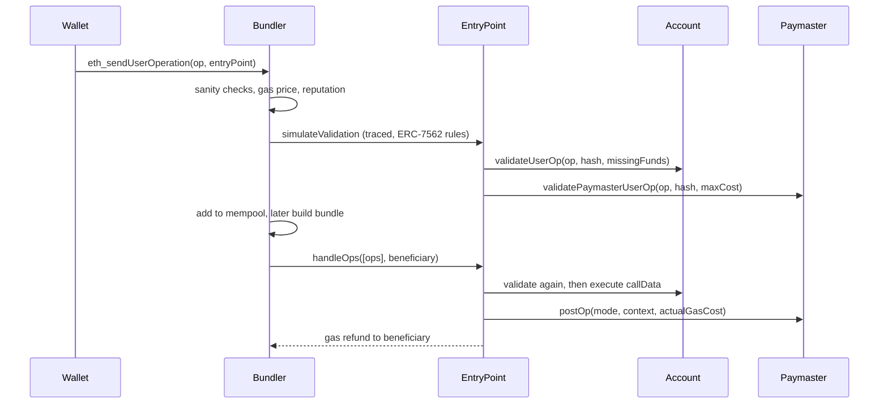

# ERC-4337 Validation Rules and Bundler Security

Bundlers simulate each `UserOperation` before including it, because they pay gas for the whole bundle. If an operation's validation passes in simulation but fails on-chain, the bundler loses money. ERC-4337 therefore restricts what validation code may do. Those restrictions (formalised in ERC-7562) are a security boundary.

## Why validation is restricted

Validation runs in `validateUserOp` (account) and `validatePaymasterUserOp` (paymaster). If it could read arbitrary state, an attacker could submit thousands of operations that all become invalid when one storage slot changes. That is a cheap denial-of-service against bundlers (mass invalidation).

Rules include:
- banned opcodes during validation (e.g. `TIMESTAMP`, `NUMBER`, `BALANCE`, `GASPRICE`, `CREATE`, with some exceptions);
- storage access limited to the account's own storage and "associated" slots;
- staking requirements for entities (factories, paymasters, aggregators) that access shared state;
- reputation tracking: entities whose operations often fail get throttled or banned.

"Associated" storage means slots keyed by the sender address, such as `balanceOf[sender]` in an ERC-20 mapping. That is why an account can check its own token balance in validation but cannot read a global price variable unless the reading entity is staked. Time-based validity is not done with `TIMESTAMP`; instead validation returns `validUntil` and `validAfter`, and the EntryPoint enforces them at execution time.

## The lifecycle of a UserOperation



Note that validation runs twice: once in the bundler's traced simulation, once on-chain. Every bundler attack is about making those two runs disagree.

## Bundler threats

| Threat | Description | Mitigation |
|---|---|---|
| Mass invalidation DoS | many ops depend on one state change | ERC-7562 rules, reputation |
| Griefing via gas | validation uses more gas on-chain than simulated | gas limits, simulation on the same state |
| Front-running bundles | other bundlers or builders copy profitable bundles | private submission to builders |
| Censorship | bundler refuses certain ops | multiple bundlers, shared mempool (ERC-4337 p2p mempool) |
| Simulation divergence | client-specific tracing differences | use tested bundler implementations and tracers |

## For account developers

- Keep validation **deterministic** and cheap.
- Return the right `validationData` (signature failure vs revert). Reverting on bad signatures breaks simulation semantics expected by bundlers.
- Check the `EntryPoint` caller: `validateUserOp` and `execute` must be callable only by the trusted EntryPoint (or the account itself).
- Handle `missingAccountFunds` correctly so the account pays prefund.
- Use the EntryPoint's 2D nonce (`key` in the top 192 bits, `sequence` in the low 64 bits) rather than inventing your own replay protection. Custom nonces are a classic source of replay bugs.

## Worked example

*Execution status: the Solidity and commands were not executed in this book's CI; verify locally. The hex conversions in step 4 were computed with Python.*

The goal is to build the validation half of an account correctly, then prove two properties with Foundry tests: only the EntryPoint can call it, and a bad signature returns failure instead of reverting.

1. Create a project and install the reference contracts (v0.7 uses `PackedUserOperation`):

```bash
forge init aa-lab && cd aa-lab
forge install eth-infinitism/account-abstraction@v0.7.0
forge install OpenZeppelin/openzeppelin-contracts
```

2. A minimal ECDSA validator. The reference `BaseAccount` already enforces the EntryPoint check and pays the prefund; we only implement signature checking:

```solidity
pragma solidity ^0.8.23;
import {BaseAccount} from "account-abstraction/core/BaseAccount.sol";
import {IEntryPoint} from "account-abstraction/interfaces/IEntryPoint.sol";
import {PackedUserOperation} from "account-abstraction/interfaces/PackedUserOperation.sol";
import {SIG_VALIDATION_FAILED, SIG_VALIDATION_SUCCESS} from "account-abstraction/core/Helpers.sol";
import {ECDSA} from "@openzeppelin/contracts/utils/cryptography/ECDSA.sol";
import {MessageHashUtils} from "@openzeppelin/contracts/utils/cryptography/MessageHashUtils.sol";

contract LabAccount is BaseAccount {
    IEntryPoint private immutable _ep;
    address public owner;
    constructor(IEntryPoint ep, address o) { _ep = ep; owner = o; }
    function entryPoint() public view override returns (IEntryPoint) { return _ep; }

    function _validateSignature(PackedUserOperation calldata op, bytes32 opHash)
        internal view override returns (uint256)
    {
        bytes32 h = MessageHashUtils.toEthSignedMessageHash(opHash);
        (address rec, ECDSA.RecoverError err,) = ECDSA.tryRecover(h, op.signature);
        if (err != ECDSA.RecoverError.NoError || rec != owner) return SIG_VALIDATION_FAILED;
        return SIG_VALIDATION_SUCCESS;
    }
}
```

`tryRecover` is used deliberately: plain `recover` reverts on malformed signatures, which turns "invalid signature" into "validation reverted" and confuses gas estimation (wallets send a dummy signature to `eth_estimateUserOperationGas`).

3. Tests:

```solidity
function test_onlyEntryPoint() public {
    PackedUserOperation memory op;
    vm.prank(address(0xBEEF));
    vm.expectRevert("account: not from EntryPoint");
    account.validateUserOp(op, bytes32(0), 0);
}

function test_badSigReturnsOne() public {
    PackedUserOperation memory op;
    op.signature = hex"deadbeef";
    vm.prank(address(entryPoint));
    uint256 vd = account.validateUserOp(op, keccak256("x"), 0);
    assertEq(vd, 1); // SIG_VALIDATION_FAILED
}
```

4. Packing time bounds. `validationData` is `authorizer | validUntil << 160 | validAfter << 208`. A signature valid from Unix time 1 700 000 000 until 1 700 003 600 with no aggregator encodes as:

```text
validUntil = 1700003600 = 0x6553ff10
validAfter = 1700000000 = 0x6553f100
validationData = (0x6553f100 << 208) | (0x6553ff10 << 160) | 0
```

The reference `Helpers.sol` provides `_packValidationData(bool sigFailed, uint48 validUntil, uint48 validAfter)`; use it instead of shifting by hand, and test the round-trip with `_parseValidationData`.

5. Optional: run a bundler (for example Rundler or Alto) against Anvil with full ERC-7562 tracing enabled (not an "unsafe" mode that skips tracing), then deploy a variant that reads `block.timestamp` in validation. The bundler should reject it during simulation with an opcode-rule error. This confirms the rule is enforced by a tool, not just by the spec.

## Common pitfalls

- Reverting on a bad signature instead of returning `SIG_VALIDATION_FAILED`. Gas estimation with dummy signatures then fails, and some bundlers treat the account as broken.
- Forgetting the EntryPoint check on `execute` or `executeBatch`, so anyone can move the account's funds directly.
- Hard-coding an EntryPoint address that differs from the one the bundler uses (v0.6 vs v0.7 vs later). The account then silently never validates.
- Reading global state (oracle prices, pool reserves) in validation. Compliant bundlers drop the op; non-compliant ones accept it and get mass-invalidated.
- Signing the raw `userOpHash` in one place and the EIP-191 prefixed hash in another, so wallet and contract disagree.
- Assuming validation runs only once. Side effects in validation (writing storage) run in both simulation and on-chain execution.

## Exercises

1. Write an account whose validation reads `block.timestamp`. Submit it to a compliant bundler and observe the rejection.
2. Write a test that calls `execute` from a non-EntryPoint address on your account. It must revert.
3. Read ERC-7562 and list the rules that protect bundlers from mass invalidation.
4. Fuzz `_packValidationData` / `_parseValidationData` with Foundry and assert the round-trip holds for all `uint48` pairs.

## Further reading

- ERC-7562 (validation scope rules): <https://eips.ethereum.org/EIPS/eip-7562>
- Bundler implementations: e.g. eth-infinitism bundler, Alto (Pimlico), Rundler (Alchemy, Rust)
- ERC-4337 docs on the shared mempool: <https://docs.erc4337.io>
- Reference `BaseAccount` and `Helpers.sol`: <https://github.com/eth-infinitism/account-abstraction/tree/develop/contracts/core>
