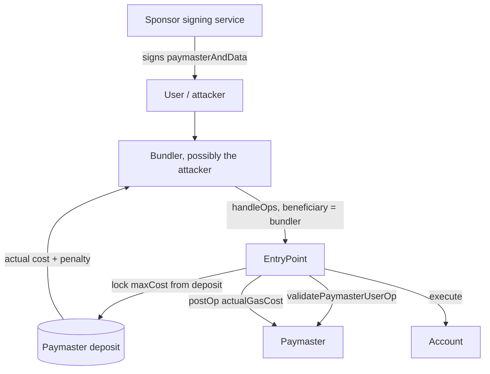

# Paymaster Security

Paymasters pay gas on behalf of users, often in exchange for ERC-20 tokens or under a sponsor's policy. They hold a deposit in the EntryPoint, and every bug in their validation logic is a way to drain it.

## Paymaster types

| Type | How it decides | Typical bugs |
|---|---|---|
| Verifying (signature) paymaster | off-chain service signs approval for specific ops | signature not bound to all fields; replay |
| ERC-20 paymaster | user pays in tokens, priced by an oracle | stale/manipulable price; post-op charge fails |
| Sponsor allowlist | free gas for certain apps or users | allowlist checked on wrong field; abuse by sybils |

## How the money flows

The EntryPoint computes a maximum cost for each operation from its gas limits and `maxFeePerGas`, and locks that much of the paymaster's deposit during validation. After execution it charges the actual gas used (plus, in v0.7 and later, a penalty on unused execution gas, see `UNUSED_GAS_PENALTY_PERCENT` in the reference EntryPoint) and refunds the rest. The charged amount is paid to the bundle's `beneficiary`, which is chosen by the bundler.

That last detail matters. If an attacker runs their own bundler, every wei the paymaster overpays lands in the attacker's pocket. A paymaster bug is therefore not just "griefing"; it is direct theft by a bundler-attacker.



## Common vulnerability patterns

1. **Incomplete signed data.** The sponsor's signature must cover the user's sender, nonce, callData hash, gas limits, chain ID, paymaster address and validity window. Missing gas fields lets an attacker inflate gas to drain the deposit.
2. **Replay across chains or paymasters.** Include `block.chainid` and `address(this)`.
3. **`postOp` failure handling.** If charging the user in `postOp` fails (insufficient tokens, revoked allowance), the paymaster has still paid gas. Pre-charge in validation, or require a sufficient allowance and balance at validation time.
4. **Oracle manipulation** in ERC-20 paymasters (see the **oracle-security-engineering** book).
5. **Gas accounting errors:** underestimating `postOp` gas or the unused-gas penalty rules of newer EntryPoint versions.

A sixth pattern is off-chain: the signing service's *policy* (which ops it agrees to sponsor) is usually where sybil abuse happens. A perfectly bound signature does not help if the service will sign anything for any fresh address.

## Defensive checklist

- [ ] Signature binds every field that affects cost and execution.
- [ ] Validity window (`validUntil`, `validAfter`) set and short.
- [ ] Per-user and global spending limits enforced off-chain *and* checked on-chain where possible.
- [ ] Token pre-charge or allowance check in validation.
- [ ] Monitoring of deposit burn rate with automatic pausing of the signing service.
- [ ] Paymaster is staked appropriately if it reads shared state, and its `withdrawTo` is owner-only.

## Worked example

*Execution status: the table is hand arithmetic under stated assumptions; the Solidity and fork test were not executed in this book's CI; verify locally.*

We quantify how much a single op can extract from a verifying paymaster whose signature omits gas fields, then fix the hash.

**Step 1: the vulnerable hash.** Suppose the sponsor signs only:

```solidity
function getHash(PackedUserOperation calldata op, uint48 until, uint48 after_)
    public view returns (bytes32)
{
    // BUG: no accountGasLimits, preVerificationGas, gasFees
    return keccak256(abi.encode(
        op.sender, op.nonce, keccak256(op.callData),
        block.chainid, address(this), until, after_
    ));
}
```

**Step 2: the attacker's edit.** The attacker obtains a legitimate sponsorship for a cheap call, then, before submitting, rewrites `gasFees` and `accountGasLimits`. The signature still verifies because those fields are not hashed.

**Step 3: the numbers.** Say the attacker sets `callGasLimit = 5 000 000`, `maxPriorityFeePerGas = maxFeePerGas = 200 gwei`, and runs the bundler themselves on a chain where the base fee is 10 gwei. The real call uses about 50 000 gas.

| Item | Value |
|---|---|
| Gas actually used (all phases, approx.) | 150 000 |
| Unused execution gas | 4 950 000 |
| Penalty at 10% of unused | 495 000 |
| Charged gas | 645 000 |
| Effective price paid by paymaster | 200 gwei |
| Cost to paymaster | 645 000 × 200 gwei = 0.129 ETH |
| Base fee burned | 645 000 × 10 gwei ≈ 0.00645 ETH (attacker pays this in the bundle tx) |
| Attacker net per op | ≈ 0.12 ETH |

The legitimate cost of the same op at a sane 1 gwei tip would have been well under 0.002 ETH. Multiply by one sponsored op per fresh address and the deposit is gone in hours. (Exact numbers depend on the EntryPoint version and chain; rerun them for your target.)

**Step 4: reproduce on a fork.** In a Foundry test, deploy the vulnerable paymaster, sign a sponsorship with `vm.sign`, mutate `op.gasFees` and `op.accountGasLimits`, call `entryPoint.handleOps(ops, payable(attacker))` from the attacker, and assert `entryPoint.balanceOf(paymaster)` fell by more than the honest cost while `attacker.balance` rose.

**Step 5: the fix.** Hash every cost-relevant field, as the reference `VerifyingPaymaster` does:

```solidity
return keccak256(abi.encode(
    op.sender, op.nonce,
    keccak256(op.initCode), keccak256(op.callData),
    op.accountGasLimits,
    uint256(bytes32(op.paymasterAndData[PAYMASTER_VALIDATION_GAS_OFFSET:PAYMASTER_DATA_OFFSET])),
    op.preVerificationGas, op.gasFees,
    block.chainid, address(this), until, after_
));
```

Rerun the test: the mutated op must now fail with `AA34 signature error`.

Remember the house rule: if an AI assistant tells you "the hash covers everything", the checker is a test that mutates each field in turn and expects failure (see the mutation exercise in the last chapter).

## Common pitfalls

- Signing a hash that omits `gasFees` or gas limits, so a bundler-attacker can inflate cost after the fact.
- Charging tokens only in `postOp` without checking balance and allowance in validation; the user revokes approval in the same op and pays nothing.
- Pricing ERC-20 gas with a spot DEX price or an unchecked oracle round.
- Forgetting the unused-gas penalty and the `postOp` gas limit when estimating what to charge the user.
- Long or missing validity windows, letting signed sponsorships be stockpiled and replayed later in a burst.
- Rate limits that are per-address only, which sybils bypass with fresh counterfactual accounts.

## Exercises

1. Write a verifying paymaster that forgets to sign gas limits. Drain its deposit on a fork with inflated gas.
2. Fix it and add a test proving the fix.
3. Build an alert that fires when paymaster deposit spend per hour exceeds 3× the trailing average.
4. Recompute the worked-example table for an L2 where L1 data cost dominates. Which field does an attacker inflate there?

## Further reading

- ERC-4337 paymaster section: <https://eips.ethereum.org/EIPS/eip-4337>
- eth-infinitism sample paymasters: <https://github.com/eth-infinitism/account-abstraction>
- Audit reports of ERC-4337 EntryPoint versions (OpenZeppelin and others), linked from the reference repo
- ERC-4337 docs, paymaster pages: <https://docs.erc4337.io>
