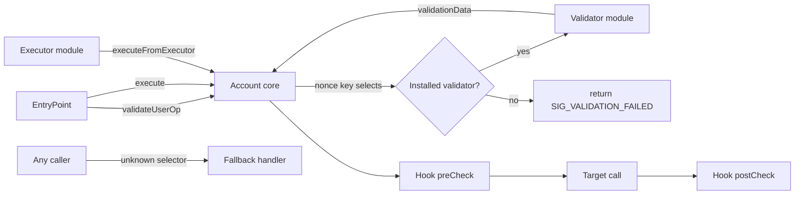

# Modular Accounts, Plugins and Session Keys

Modular smart accounts (ERC-7579, ERC-6900) let users install validators, executors, hooks and fallback handlers. This is flexible, and it turns the account into a plugin host. Plugin hosts have a long history of security problems.

## Module types (ERC-7579 terms)

| Type | Power |
|---|---|
| Validator | decides if a signature/UserOp is valid; can authorise anything |
| Executor | can make the account execute calls |
| Hook | runs before/after execution; can block or observe |
| Fallback handler | handles calls to unknown selectors |

A malicious or buggy validator or executor is equivalent to giving away the account.

## How a modular account routes a UserOp

In ERC-7579 accounts the validator is usually selected by encoding its address into the UserOp nonce key or the signature prefix. The account looks the validator up, checks it is installed, and forwards the op. Hooks wrap execution.



Notice the two side doors: executors call into the account outside the EntryPoint path, and the fallback handler answers any selector the core does not implement. Both are reachable without a UserOp signature, so their access control is the account's access control.

## Risks

- **Malicious module installation** via phishing ("install this module to claim your airdrop").
- **Module storage collisions** in accounts that share storage across modules.
- **Uninstall bugs:** modules that leave state behind or block their own removal.
- **Fallback handler surprises:** a handler that answers `isValidSignature` (ERC-1271) for everything makes the account "sign" any message for off-chain protocols such as permits.
- **Session key scope bugs:** limits enforced on `target` but not on `selector`, on value but not on token amounts in calldata, or no expiry.
- **Hook bypass:** an executor path (`executeFromExecutor`) that skips the hooks the user relied on for spending limits.
- **Re-install state reuse:** a module uninstalled and later re-installed picks up stale configuration, for example an old session key that was never cleared.

## Module registries and attestations

ERC-7484 defines a registry where auditors attest to modules. Accounts can require attestations from a threshold of trusted attesters before installing a module. Treat this like package signing: it raises the bar but depends on who you trust.

A registry check happens at install time and, in some designs, at every use. If it only happens at install, revoking an attestation does not protect accounts that already installed the module. Ask which one your target does.

## Session key design checklist

- [ ] Target contract allowlist.
- [ ] Function selector allowlist per target.
- [ ] Argument constraints (recipient == account, amount ≤ limit).
- [ ] Cumulative spend limits per period.
- [ ] Expiry and revocation that work even if the session key is malicious.
- [ ] No ability to install modules or change validators.
- [ ] Policies apply to batched calls element by element, not just to the outer `execute`.

## Worked example

*Execution status: not executed in this book's CI; verify locally.*

We build a deliberately weak session-key validator, exploit it in a Foundry test, and then fix it. Everything runs locally against a mock token.

**Step 1: the weak policy.** The session key may call the token contract, intended for `transfer` up to 100 tokens to a fixed merchant:

```solidity
struct Session { address key; address target; uint48 validUntil; }

function _checkCall(Session memory s, address to, uint256 value, bytes calldata data)
    internal view returns (bool)
{
    // BUG: only the target is checked
    return to == s.target && value == 0 && block.timestamp <= s.validUntil;
}
```

**Step 2: the exploit.** The session key (assume it leaked from a browser extension) builds a call to the allowed token, but with `approve`:

```solidity
bytes memory data = abi.encodeCall(IERC20.approve, (attacker, type(uint256).max));
// executed via the account with the session key's signature
```

Then, from the attacker EOA, `token.transferFrom(account, attacker, token.balanceOf(account))`. In the test, assert the account balance went to zero. The "100 token transfer to merchant" policy never had a chance: the policy was on the address, not on the action.

**Step 3: the fix.** Decode and constrain the calldata:

```solidity
function _checkCall(Session memory s, address to, uint256 value, bytes calldata data)
    internal returns (bool)
{
    if (to != s.target || value != 0 || block.timestamp > s.validUntil) return false;
    if (data.length != 68 || bytes4(data[:4]) != IERC20.transfer.selector) return false;
    (address rcpt, uint256 amt) = abi.decode(data[4:], (address, uint256));
    if (rcpt != MERCHANT) return false;
    spent[s.key] += amt;              // cumulative, not per call
    return spent[s.key] <= LIMIT;
}
```

Note the `data.length` check: without it, an attacker can append junk that ABI decoding ignores but some downstream parser reads. The function also writes storage. In a 4337 validator, that write happens during validation and must use account-associated storage to satisfy ERC-7562; many implementations move spend tracking into a hook for that reason.

**Step 4: the regression test.** Fuzz the policy: for random `(to, selector, rcpt, amt)` tuples, assert the call is accepted only when all four constraints hold and cumulative spend stays under the limit. Foundry's `forge test --fuzz-runs 10000` gives reasonable confidence; an invariant test with a handler that tries random calls is better.

**Step 5: the ERC-1271 trap.** Install a fallback handler whose `isValidSignature` returns `0x1626ba7e` for any input. Produce an EIP-2612 permit for a token that supports ERC-1271 contract signatures, "signed" by the account, and show that `permit` succeeds with an arbitrary signature. That single module turns the account into a blank cheque for any protocol that trusts ERC-1271.

## Common pitfalls

- Checking only `target` in session policies, as in the worked example. `approve`, `setApprovalForAll` and `transferFrom` all live on the same address as `transfer`.
- Applying policies to the outer `execute` but not to each element of `executeBatch` or to `delegatecall` execution modes.
- Allowing session keys to call the account itself, which reaches `installModule` and lets the key promote itself to a full validator.
- Revocation that requires the session key's cooperation, or that only works while the key's expiry is still in the future.
- Fallback handlers that implement ERC-1271 without binding signatures to the account address and chain, enabling replay across a user's accounts.
- Trusting registry attestations checked once at install time as if they were continuous.

## Exercises

1. Write a session-key validator that checks target but not selector, and exploit it by calling `approve` on an allowed token.
2. Write a fallback handler that answers ERC-1271 for everything and show a permit signed "by" the account.
3. Read ERC-7484 and design an attester policy for a team wallet.
4. Take an open-source ERC-7579 account and list every external function reachable without an EntryPoint call. Which ones are protected only by "is installed module" checks?

## Further reading

- ERC-7579: <https://eips.ethereum.org/EIPS/eip-7579>
- ERC-6900: <https://eips.ethereum.org/EIPS/eip-6900>
- ERC-7484 (module registry): <https://eips.ethereum.org/EIPS/eip-7484>
- ERC-1271: <https://eips.ethereum.org/EIPS/eip-1271>
- EIP-2612 (permit): <https://eips.ethereum.org/EIPS/eip-2612>
- Rhinestone ModuleKit (testing ERC-7579 modules): <https://github.com/rhinestonewtf/modulekit>
