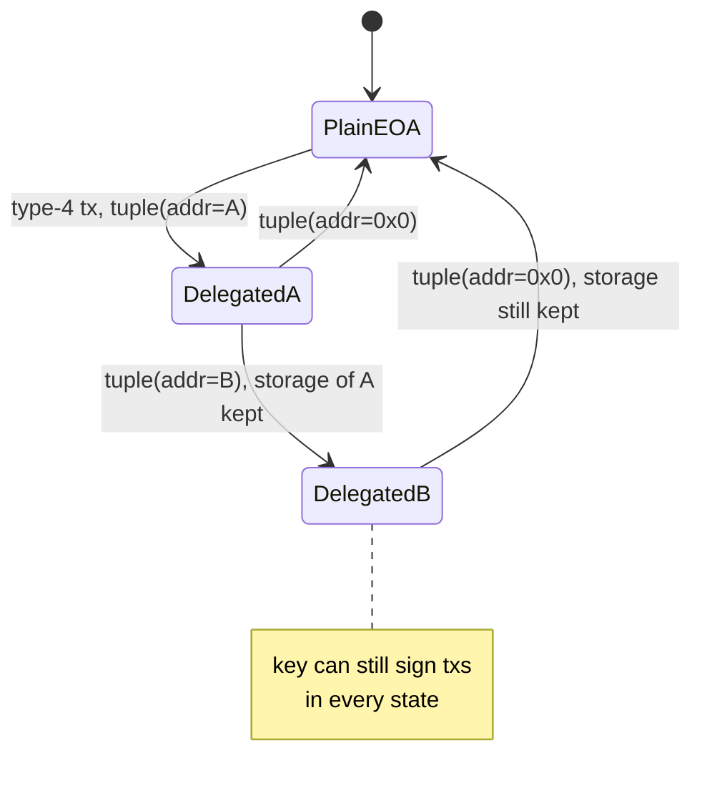

# EIP-7702 in Depth

EIP-7702 adds a transaction type (type 4) carrying a list of **authorisation tuples** `(chain_id, address, nonce, signature)`. Each tuple makes the signer's EOA delegate its code to `address`. Afterwards, calls to the EOA run the delegate's code in the EOA's storage context, while the original private key still works.

## Mechanics in brief

The signer signs `keccak256(0x05 || rlp([chain_id, address, nonce]))`. When the type-4 transaction is processed, for each valid tuple the client sets the EOA's code to the 23-byte **delegation designator** `0xef0100 || address` and increments the EOA's nonce. Anyone can submit the transaction; the authority comes from the tuple signature, not from the transaction sender. That is what makes sponsored ("gasless") delegation possible, and also what makes a leaked tuple dangerous.

Delegating to the zero address clears the code and returns the account to a plain EOA. Storage is **not** cleared.

## What this means for security

1. **The key is still the root of trust.** Delegating does not remove the private key; anyone with the key can re-delegate or send transactions directly.
2. **A signed authorisation is as powerful as the key**, for as long as it stays active. Signing a delegation to a malicious contract gives away everything. Drainer kits added 7702 phishing soon after Pectra went live.
3. **`chain_id = 0` authorisations are valid on every chain** that supports 7702. Never sign them for anything except a contract you trust deployed at the same address everywhere.
4. **Storage persists across re-delegation.** Switching from delegate A to delegate B leaves A's storage in place. B may misread it (storage collisions). Delegates should use namespaced storage (ERC-7201).
5. **Initialisation front-running:** if a delegate needs an `initialize` call after delegation, someone else might call it first. Initialisation should require the EOA's own signature or happen in the same transaction.
6. **Broken assumptions:** `tx.origin == msg.sender` no longer implies "no code", and `extcodesize == 0` checks behave differently.
7. **Nonce interplay:** the tuple nonce must equal the EOA's current nonce. If the EOA is also the transaction sender, its nonce is incremented for the transaction *before* tuples are processed, so the tuple must carry `nonce + 1`. Tooling gets this wrong often enough that it deserves a test.



## Wallet and UI guidance

- Wallets should only allow delegation to a short allowlist of audited delegates, and refuse generic dapp requests to delegate.
- Display delegation clearly, including chain ID and whether it is chain-agnostic.
- Show the account's current delegation status, and offer one-click revocation (delegating to the zero address).

## Auditing a delegate contract

- [ ] Namespaced storage (ERC-7201).
- [ ] No unprotected initialiser.
- [ ] `execute` callable only by the EOA itself (`msg.sender == address(this)`) or by validated signatures with nonces.
- [ ] Signature replay protection includes chain ID and the account address.
- [ ] Safe behaviour if the private key is also used directly (nonce interplay).
- [ ] Receives ETH, ERC-721 and ERC-1155 safely (`receive`, `onERC721Received`, `onERC1155Received`), since the EOA could receive them before delegation.

## Worked example

*Execution status: not executed in this book's CI; the outputs shown are what the tests are expected to print. Verify locally.*

This example uses Foundry's 7702 cheatcodes to show the storage-collision problem and its fix, all in one `forge test` run.

**Step 1: two delegates with colliding layouts.**

```solidity
contract DelegateA {            // slot 0: owner
    address public owner;
    function init(address o) external { require(owner == address(0)); owner = o; }
}

contract DelegateB {            // slot 0: dailyLimit (collides!)
    uint256 public dailyLimit;
    function spend(uint256 amt) external view returns (bool) { return amt <= dailyLimit; }
}
```

**Step 2: delegate, initialise, re-delegate.**

```solidity
function test_storageCollision() public {
    (address alice, uint256 pk) = makeAddrAndKey("alice");
    DelegateA a = new DelegateA();
    DelegateB b = new DelegateB();

    vm.signAndAttachDelegation(address(a), pk);
    vm.prank(alice);
    DelegateA(alice).init(alice);

    vm.signAndAttachDelegation(address(b), pk);
    uint256 limit = DelegateB(alice).dailyLimit();
    emit log_named_uint("dailyLimit", limit);
    assertEq(limit, uint256(uint160(alice)));
}
```

Expected output (the number is Alice's address read as an integer):

```text
[PASS] test_storageCollision()
Logs:
  dailyLimit: <a 45-49 digit integer equal to uint160(alice)>
```

DelegateB now believes the daily limit is an astronomically large number. Any spending policy based on it is void.

**Step 3: the front-run.** Note also that `init` in DelegateA is unprotected. Between Alice's delegation and her `init` call, anyone can call `DelegateA(alice).init(attacker)`. Write a second test where `vm.prank(attacker)` calls `init` first, and assert `owner == attacker`. Fixes: make `init` require `msg.sender == address(this)`, or verify an EIP-712 signature by Alice's key over the init parameters, or bundle the init call into the same type-4 transaction.

**Step 4: the fix for collisions.** Move each delegate's state into an ERC-7201 namespace:

```solidity
/// @custom:storage-location erc7201:lab.delegateB.v1
struct BStorage { uint256 dailyLimit; }
bytes32 constant B_SLOT =
    keccak256(abi.encode(uint256(keccak256("lab.delegateB.v1")) - 1)) & ~bytes32(uint256(0xff));
function _b() private pure returns (BStorage storage s) { assembly { s.slot := B_SLOT } }
```

Rerun: `dailyLimit` now reads 0 after re-delegation, and the test assertion flips. Keep both tests; they document why namespacing matters.

**Step 5: on a node.** Repeat with real transactions on `anvil --hardfork prague` using `cast send --auth <delegate>`, then confirm the designator with `cast code <eoa>`. Revoke with `cast send --auth 0x0000000000000000000000000000000000000000` and confirm with `cast storage <eoa> 0` that the old value is still there.

## Common pitfalls

- Delegates with plain sequential storage, assuming they are the only code that will ever run at the address.
- Unprotected `initialize` functions, callable by anyone between delegation and setup.
- Signing `chain_id = 0` tuples for convenience, granting the delegation on every 7702 chain at once.
- Off-by-one nonces when the EOA both sends the type-4 transaction and signs the tuple.
- Assuming revocation (delegating to zero) wipes state; a later delegate can still read it.
- Delegates whose `execute` trusts `msg.sender == address(this)` but which also expose a fallback that forwards calls, effectively letting outsiders act as `this`.

## Exercises

1. On a local Pectra-enabled fork (Anvil supports it), delegate an EOA to a simple batch-executor and run a batch.
2. Re-delegate to a second contract whose storage layout collides with the first. Show the corrupted reading.
3. Write a detector for type-4 transactions whose authorisation targets an unverified contract.
4. Write a test that demonstrates the sender-is-signer nonce rule: one tuple signed with the current nonce (skipped) and one with `nonce + 1` (applied).

## Further reading

- EIP-7702: <https://eips.ethereum.org/EIPS/eip-7702>
- ERC-7201 (namespaced storage): <https://eips.ethereum.org/EIPS/eip-7201>
- Foundry cheatcodes for 7702 (`vm.signDelegation`, `vm.attachDelegation`): <https://book.getfoundry.sh/cheatcodes/>
- EIP-712 (typed structured data signing): <https://eips.ethereum.org/EIPS/eip-712>
