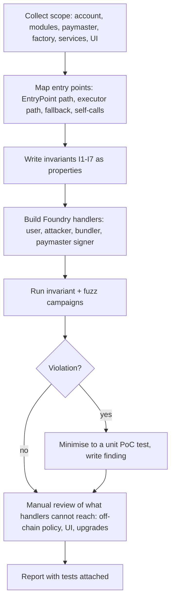

# Auditing AA Systems End to End

This chapter turns the book into an audit procedure for a smart account, a paymaster, or a wallet product built on AA.

## Scope map

| Component | Key questions |
|---|---|
| Account core | who can call `execute`; signature scheme; nonce handling; upgrade path |
| Validators / modules | install/uninstall rules; registry checks; storage layout |
| Paymaster | signed fields; deposit protection; postOp charging |
| Factory | deterministic addresses; initialisation front-running (`initCode` bound to owner) |
| Off-chain signer services | key custody; rate limits; policy logic |
| Wallet UI | what users see when signing UserOps, 7702 auths and session grants |

## Audit flow



The diagram is deliberately test-centric. AA bugs tend to be "this field is not bound" or "this path skips that check" bugs, and both are cheap to express as failing tests once you know the shape.

## Mapping entry points

Start by listing every external function on the account and its modules, and classifying the caller each one expects:

| Caller class | Example functions | Expected guard |
|---|---|---|
| EntryPoint | `validateUserOp`, `execute`, `executeBatch` | `msg.sender == entryPoint` |
| Self | `installModule`, `upgradeToAndCall` | `msg.sender == address(this)` or EntryPoint |
| Installed executor | `executeFromExecutor` | module registered as executor type |
| Anyone | `isValidSignature`, fallback, `receive` | must be read-only or safe for any caller |
| Factory | `initialize` | only once, only from factory, bound to owner |

Any function whose guard does not match its class is a candidate finding. `slither` with `--print function-summary` or `forge inspect <Contract> methodIdentifiers` give the raw list quickly; cross-check against the account's own documentation.

## Invariants to test

```
I1: only EntryPoint or self can trigger execution
I2: a UserOp with an invalid signature never executes
I3: nonces cannot be replayed (incl. across chains and accounts)
I4: paymaster deposit decreases only for ops the sponsor approved
I5: a session key never spends more than its limits
I6: uninstalling a module removes all its powers
I7: counterfactual address depends on owner, so nobody else can deploy "your" account with their key
```

Write these as Foundry invariant tests with handlers that act as user, attacker, bundler and paymaster signer.

## Worked example

*Execution status: not executed in this book's CI; verify locally.*

Here is a compact handler and invariant for I1 and I2, plus a mutation test for paymaster-signed fields. It assumes a `LabAccount` like the one in chapter 2, extended with a SimpleAccount-style `execute(address,uint256,bytes)` guarded by the EntryPoint check, and the reference EntryPoint deployed in `setUp`.

**Step 1: a handler that tries to break I1.**

```solidity
contract AttackerHandler is Test {
    LabAccount acc; MockERC20 token; uint256 public illegalSuccesses;
    constructor(LabAccount a, MockERC20 t) { acc = a; token = t; }

    function directExecute(address caller, uint256 amt) external {
        vm.assume(caller != address(acc.entryPoint()) && caller != address(acc));
        amt = bound(amt, 1, token.balanceOf(address(acc)) + 1);
        vm.prank(caller);
        try acc.execute(address(token), 0, abi.encodeCall(token.transfer, (caller, amt))) {
            illegalSuccesses++;
        } catch {}
    }
}
```

**Step 2: the invariant.**

```solidity
function setUp() public {
    // ... deploy entryPoint, acc, token; fund acc
    handler = new AttackerHandler(acc, token);
    targetContract(address(handler));
}

function invariant_onlyEntryPointExecutes() public view {
    assertEq(handler.illegalSuccesses(), 0);
}
```

Run with `forge test --mt invariant_ -vv`. Expected: `[PASS]` with a run count and call count. To check the harness actually has teeth, temporarily delete the EntryPoint check from `execute` and rerun; the invariant must fail with a shrunk call sequence. A harness that cannot detect a planted bug proves nothing.

**Step 3: mutation test for signed fields (I4).**

```solidity
function test_everyFieldIsBound() public {
    for (uint256 i; i < 7; i++) {
        PackedUserOperation memory m = _sponsoredOp(); // fresh copy, signed by sponsor key
        if (i == 0) m.sender = address(0xdead);
        if (i == 1) m.nonce += 1;
        if (i == 2) m.callData = hex"00";
        if (i == 3) m.accountGasLimits = bytes32(uint256(m.accountGasLimits) + 1);
        if (i == 4) m.preVerificationGas += 1;
        if (i == 5) m.gasFees = bytes32(uint256(m.gasFees) + 1);
        if (i == 6) m.initCode = hex"01";
        vm.prank(address(entryPoint));
        (, uint256 vd) = paymaster.validatePaymasterUserOp(m, entryPoint.getUserOpHash(m), 1 ether);
        assertEq(uint160(vd), 1, string.concat("field not bound: ", vm.toString(i)));
    }
}
```

Each iteration changes exactly one field and expects signature failure. If the assertion message says `field not bound: 5`, you have a gas-fee inflation finding. This is the concrete checker for any claim, human or AI, that "the hash covers all fields". The op is rebuilt each iteration on purpose: assigning one memory struct to another copies the reference, so `m = op` would let mutations accumulate across iterations.

**Step 4: report.** Attach the failing test to the finding. Reviewers and the client can rerun it and later keep it as a regression test.

## Using AI in AA audits

Good uses: enumerating all paths to `execute`, comparing signed-field lists against the struct layout, and generating handler skeletons. Verify each claim with an invariant test. Do not accept "the signature covers all fields" without a test that mutates each field and expects failure.

A practical loop: ask the model for a list of candidate unguarded paths, turn each candidate into a handler function, and let the fuzzer decide. Candidates the fuzzer cannot reach are not findings until a unit test reaches them. The model proposes, the checker decides.

## Common pitfalls

- Auditing the account core but not the modules and fallback handlers installed by default in the product.
- Invariant harnesses that never call the risky functions because handlers bound inputs too tightly or always revert early. Check call counts and coverage.
- Testing only the latest EntryPoint version while the product supports several.
- Ignoring the factory: an `initCode` that does not bind the owner lets anyone deploy "your" counterfactual account with their own key.
- Treating off-chain signer policy and wallet UI as out of scope, even though most real losses in AA products start with what the user was shown and signed.

## Exercises

1. Implement I1–I7 for an open-source modular account.
2. Mutate each field of a paymaster-signed payload in a test and confirm verification fails each time.
3. Write a one-page AA audit checklist for your team.
4. Plant a bug in your account (remove one guard), and measure how many invariant runs it takes your harness to find it.

## Further reading

- See **ai-assisted-audit-playbook** and **ai-agent-wallet-security** in this wiki.
- Safe smart account: <https://github.com/safe-global/safe-smart-account>
- Kernel (ZeroDev): <https://github.com/zerodevapp/kernel>
- Foundry invariant testing guide: <https://book.getfoundry.sh/forge/invariant-testing>
- Slither: <https://github.com/crytic/slither>
